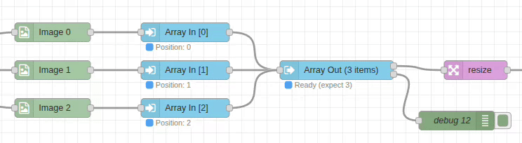

# Utility Nodes for Node-RED

`@rosepetal/node-red-contrib-utils` provides 9 utility nodes for array assembly, message queueing, rate limiting, file saving, promise aggregation, safe debugging, and event loop monitoring.



## Installation

```bash
cd ~/.node-red
npm install @rosepetal/node-red-contrib-utils
```

Or search `@rosepetal/node-red-contrib-utils` in the Node-RED Palette Manager.

## Requirements

- Node.js >= 16 (the *Disk Limit* check of `rp-save-file` needs Node.js 18.15 or later)
- Node-RED >= 1.0.0
- `sharp` native addon (fetched via npm)

## Nodes

All node types are prefixed with `rp-` and appear under the **RP Utils** category in the editor.

### I/O and Array Tools

| Node | Purpose |
|------|---------|
| **[rp-array-in](./nodes/io/array-in.md)** | Tag incoming data with a position index for ordered array assembly |
| **[rp-array-out](./nodes/io/array-out.md)** | Collect indexed data into ordered arrays with timeout handling |
| **[rp-array-select](./nodes/io/array-select.md)** | Select array elements using index and slice syntax |
| **[rp-queue](./nodes/io/queue.md)** | Buffer messages, enforce output intervals, drop stale or overflow items |
| **[rp-save-file](./nodes/io/save-file.md)** | Save payloads to disk as image (JPEG, PNG, WebP, BMP), JSON, text, or binary |
| **[rp-rate-limit](./nodes/io/rate-limit.md)** | Enforce minimum interval between outputs based on external timestamps |

### Async and Workflow

| Node | Purpose |
|------|---------|
| **[rp-promise-reader](./nodes/promise-reader/promise-reader.md)** | Resolve arrays of promises, merge results, and record timing |

### Utilities

| Node | Purpose |
|------|---------|
| **[rp-clean-debug](./nodes/util/clean-debug.md)** | Debug output that sanitizes large payloads to keep the sidebar responsive |
| **[rp-block-detect](./nodes/util/block-detect.md)** | Event loop delay watchdog with live status and log warnings |

## Non-blocking by design

The nodes keep heavy work off the Node-RED event loop:

- Filesystem access uses `fs.promises` and streams.
- Image encoding runs on Sharp's thread pool. Pixel work written in JavaScript (BGR/RGB reordering, raw BMP and PNG encoding) runs on a small worker-thread pool: one worker kept warm, up to `min(4, cores - 1)`, or the number set in the `RP_CPU_WORKERS` environment variable. See [rp-save-file](./nodes/io/save-file.md#behavior).
- `flow` / `global` context is read and written through Node-RED's asynchronous context API, so asynchronous context stores are supported.
- Debug sanitisation is bounded (depth, key, array and string-sample limits) and never deep-clones the message. See [rp-clean-debug](./nodes/util/clean-debug.md).
- [rp-block-detect](./nodes/util/block-detect.md) watches the event loop and logs a warning when something blocks it.
