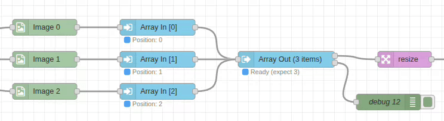

# Array-In Node

## Purpose & Use Cases

The `array-in` node collects data from various sources and tags it with position information for ordered array assembly. It works in partnership with the `array-out` node to create structured arrays from multiple parallel data streams.

**Real-World Applications:**
- **Batch Image Processing**: Collect multiple images for simultaneous processing
- **Data Aggregation**: Combine results from parallel processing pipelines
- **Multi-Source Analysis**: Merge data from different sensors or inputs
- **Synchronized Processing**: Ensure data maintains order through parallel workflows
- **Multi-Camera Systems**: Collect images from multiple cameras in correct sequence



## Input/Output Specification

### Inputs
- **Input Message**: Message containing data at the configured input path
- **Dynamic Position**: Array position can be resolved from a message property or from flow or global context

### Outputs
One output. The node sends the incoming message on with `msg.meta` added (created when the message has none). It copies the value into `msg.payload` only when **Input from** is `msg.payload`; for any other input the payload is left as it was and the value travels in `msg.meta.arrayData`:

```javascript
{
  ...originalMessage,
  payload: any,           // Unchanged unless input is msg.payload; when mirrored matches meta.arrayData
  meta: {
    arrayPosition: number,  // Index where this data belongs in array
    arrayData: any         // The extracted data from input path
  }
}
```

## Configuration Options

### Input From
- **Default**: `msg.payload`
- **Options**:
  - `msg.*` - Read from message property
  - `flow.*` - Read from flow context
  - `global.*` - Read from global context
- **Purpose**: Specifies where to extract the data to be included in the array

### Array Position
- **Default**: `0` (fixed number)
- **Options**:
  - **Fixed Number**: Static position (0, 1, 2, ...)
  - **msg.***: Dynamic position from message property
  - **flow.***: Position from flow context
  - **global.***: Position from global context
- **Range**: Non-negative integers (0-based indexing). The value is read with `parseInt`, so `2.7` and `"2"` both give `2`; an empty value means `0`.
- **Purpose**: Determines where this data appears in the final array

## Performance Notes

### Array Assembly Strategy
- **Position Tagging**: Lightweight metadata addition with minimal processing overhead
- **No Copies**: `msg.meta.arrayData` holds a reference to the value, not a copy
- **Parallel Collection**: Multiple array-in nodes can operate simultaneously
- **Order Preservation**: The position, not the arrival order, decides where the value ends up in the array

### Status Display
- **Blue dot** `Position: 0` (or `Position: msg.index` for a dynamic position) after deploy
- **Green dot** `Position: <n>` with the position used for the last message
- **Red ring** `Invalid position` when the position cannot be resolved, `Error` on any other failure

## Real-World Examples

### Basic Multi-Image Collection
```
[Image-In: photo1.jpg] → [Array-In: pos=0] ┐
[Image-In: photo2.jpg] → [Array-In: pos=1] ├→ [Array-Out] → [Resize All]
[Image-In: photo3.jpg] → [Array-In: pos=2] ┘
```
Collect three images into an ordered array for batch processing.

### Dynamic Position Assignment
```
[Process Data] → [Set msg.index] → [Array-In: pos=msg.index] → [Array-Out]
```
Use dynamic positioning based on processing results.

### Mixed Data Sources
```
[msg.image1] → [Array-In: pos=0] ┐
[flow.image2] → [Array-In: pos=1] ├→ [Array-Out] → [Concat Images]
[global.image3] → [Array-In: pos=2] ┘
```
Combine data from different context levels.

### Conditional Assembly
```
[Switch] → [Array-In: pos=flow.nextIndex] → [Array-Out]
```
Dynamic array building based on conditions.

## Common Issues & Troubleshooting

### Position Conflicts
- **Issue**: Multiple nodes using same position
- **Solution**: Ensure each array-in node has unique position when feeding same array-out
- **Best Practice**: Use sequential positions starting from 0

### Missing Data
- **Issue**: Input path contains no data
- **Result**: The warning `No data found at msg.payload` (with the configured path) is logged, `meta.arrayData` is set to `null` and the message is still sent
- **Solution**: Verify data exists at specified input path before processing

### Dynamic Position Errors
- **Issue**: Position resolves to a value that is not a number, or to a negative number
- **Result**: The warning `Failed to resolve array position: ...` is logged, the status shows `Invalid position` and the message is dropped
- **Solution**: Validate dynamic position sources return valid array indices
- **Check**: Use debug node to verify position values

### Array Gaps
- **Issue**: Positions skip numbers, or some positions never arrive
- **Result**: `array-out` only accepts positions `0` to *Expected Count* - 1 and completes an array only when all of them arrive. If one is missing, its timeout sends the partial array, with `null` at the missing positions, to its second output
- **Solution**: Use sequential positions starting from 0 and set *Expected Count* in `array-out` to their number
