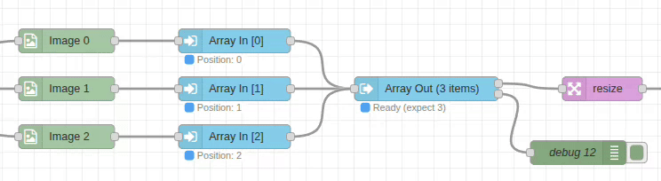

# Array-Out Node

## Purpose & Use Cases

The `array-out` node serves as the collection point for multiple `array-in` nodes, assembling ordered arrays from parallel data streams. It provides timeout protection and ensures data integrity during the assembly process.

**Real-World Applications:**
- **Batch Image Processing**: Assemble multiple images for simultaneous operations
- **Multi-Camera Synchronization**: Collect frames from multiple cameras in sequence
- **Parallel Pipeline Merging**: Combine results from parallel processing workflows
- **Data Aggregation**: Merge processed data from multiple sources
- **Quality Control**: Collect inspection results from multiple checkpoints



## Input/Output Specification

### Inputs
Messages from `array-in` nodes containing:
```javascript
{
  ...originalMessage,
  payload: any,           // Fallback data source
  meta: {
    arrayPosition: number,  // Position index (0, 1, 2, ...)
    arrayData: any         // Preferred data source (takes priority over payload)
  }
}
```

**Data Extraction Priority**: The node prefers `msg.meta.arrayData` but falls back to `msg.payload` if arrayData is undefined.

**Accepted positions**: `0` to *Expected Count* - 1. A message without a numeric `msg.meta.arrayPosition` is ignored with the warning `Message missing array metadata. Expected msg.meta.arrayPosition (number) from rp-array-in node`; a position outside the range is ignored with the warning `Position 5 out of range 0‑2` (for an Expected Count of 3).

### Outputs

#### Output 1 - Complete Array (Success)
Sent when the last missing position arrives. The message is a shallow copy of that last message, with the ordered array written to **Output to** (`msg.payload` by default); its other properties, `meta` included, are those of the last message:

```javascript
{
  ...lastMessage,
  payload: [data0, data1, data2, ...]  // Ordered array of collected data
}
```

#### Output 2 - Timeout Data (Error)
Sent when **Timeout** expires first. It is a new message: it carries only `meta` and the partial array, with `null` at the missing positions. No property of the collected messages is copied into it.

```javascript
{
  [outputPath]: [data0, null, data2, ...],  // Partial array in configured location
  meta: {
    timeout: true,                     // Timeout flag
    missingPositions: [1, 4],         // Positions that didn't arrive
    collectedPositions: [0, 2, 3],    // Positions that were collected
    expectedCount: 5,                 // Number expected
    collectedCount: 3,                // Number actually collected
    elapsed: 5000                     // Time elapsed in milliseconds
  }
}
```

## Configuration Options

### Expected Count
- **Type**: Number (required)
- **Default**: `2`
- **Range**: Minimum 1. A value that is not a positive integer logs the error `Invalid expectedCount. Must be a positive integer.` at deploy and the node uses `2`
- **Purpose**: Number of array elements required before output
- **Validation**: Should equal the number of positions sent by the connected array-in nodes (`0` to Expected Count - 1); the node does not check the wiring
- **Impact**: Array assembly completes when this many different positions are collected

### Timeout
- **Type**: Number (milliseconds)
- **Default**: 5000ms (5 seconds)
- **Range**: The editor field has a minimum of 100ms; an empty or `0` value means 5000ms
- **Purpose**: Maximum wait time for all elements after first message. The timer starts with the first message of a set and is not restarted by the following ones
- **Behavior**: Sends partial data to output 2 on timeout

### Output to
- **Default**: `msg.payload`
- **Options**:
  - `msg.*` - Store in message property
  - `flow.*` - Store in flow context
  - `global.*` - Store in global context
- **Purpose**: Where to store the assembled array. With `flow` or `global` the array goes to the context and the message sent on output 1 is the last message unchanged; on output 2 it carries only `meta`

## Performance Notes

### Assembly Strategy
- **Efficient Collection**: Uses position-based indexing for O(1) insertion
- **Memory Management**: Minimal overhead during collection
- **Timeout Protection**: Prevents indefinite waiting for missing data
- **State Reset**: Automatic cleanup between collection cycles

### Status Display
- **Ready**: Blue dot `Ready (expect 3)` while waiting for the first message of a set
- **Collection Progress**: Yellow dot `Collecting… (2/3)`
- **Success Timing**: Green dot `Complete: 3 (12 ms)`, with the time since the first message of the set; back to `Ready` after 2 seconds
- **Timeout Warning**: Yellow ring `Timeout: sent 2/3 to output 2`; back to `Ready` after 3 seconds
- **Error**: Red ring `Error`; the set being collected is discarded

## Real-World Examples

### Basic Image Array Assembly
```
[Image-In: img1.jpg] → [Array-In: pos=0] ┐
[Image-In: img2.jpg] → [Array-In: pos=1] ├→ [Array-Out: count=3, timeout=500] → [Resize: All Images]
[Image-In: img3.jpg] → [Array-In: pos=2] ┘
```
Collect three images for batch resizing.

### Multi-Camera Frame Collection
```
[Camera 1] → [Array-In: pos=0] ┐
[Camera 2] → [Array-In: pos=1] ├→ [Array-Out: count=4, timeout=100] → [Sync Analysis]
[Camera 3] → [Array-In: pos=2] │
[Camera 4] → [Array-In: pos=3] ┘
```
Synchronize frames from multiple cameras with tight timing.

### Parallel Processing Merge
```
→ [Process A] → [Array-In: pos=0] ┐
→ [Process B] → [Array-In: pos=1] ├→ [Array-Out: count=3, timeout=500] → [Combine Results]
→ [Process C] → [Array-In: pos=2] ┘
```
Merge results from parallel processing pipelines.

### Quality Control Assembly
```
[Inspection A] → [Array-In: pos=0] ┐
[Inspection B] → [Array-In: pos=1] ├→ [Array-Out: timeout=10000] → [Final Report]
[Inspection C] → [Array-In: pos=2] ┘
```
Collect quality control results with extended timeout.

## Common Issues & Troubleshooting

### Timeout Issues
- **Issue**: Frequent timeouts preventing array completion
- **Causes**: Slow upstream processing, network delays, missing data
- **Solutions**:
  - Increase timeout value for slow processes
  - Add debug nodes to identify bottlenecks
  - Implement fallback logic using output 2

### Count Mismatch
- **Issue**: Expected count doesn't match number of array-in nodes
- **Result**: If it is higher, every set ends in a timeout on output 2. If it is lower, the positions at or above Expected Count are ignored with a warning and the array is shorter than intended
- **Solution**: Verify expected count equals number of connected array-in nodes

### Position Conflicts
- **Issue**: Multiple array-in nodes using same position
- **Result**: The later message replaces the earlier one and the position is counted once, so the set waits for a position that never comes and ends in a timeout
- **Solution**: Ensure each array-in node has unique position

### Missing Metadata
- **Issue**: Messages arriving without proper meta.arrayPosition
- **Result**: Messages ignored with a warning, incomplete arrays
- **Solution**: Verify all input messages come from array-in nodes
