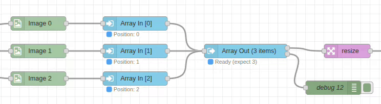

# @rosepetal/node-red-contrib-utils

Utility and I/O nodes for Node-RED, focused on array assembly, queueing, safe debugging, promise aggregation, event loop monitoring, and file saving.



## Quick Start

### Installation (Palette Manager)
- Open Palette Manager -> Install -> search `@rosepetal/node-red-contrib-utils`.

### Installation (npm)
```bash
cd ~/.node-red
npm install @rosepetal/node-red-contrib-utils
```

## Requirements

- Node.js >= 18.17 (required by `sharp` 0.34)
- Node-RED >= 1.0.0
- `sharp` native addon (fetched via npm; builds from source if no prebuilt is available)

## Node Type Prefix

All node types are prefixed with `rp-` to avoid collisions with other packages. In flow JSON you will see types like `rp-array-in`. In the editor, nodes appear under the "RP Utils" category with human-friendly labels.

## Nodes

### I/O and Array Tools

| Node | Purpose |
|------|---------|
| **[rp-array-in](docs/nodes/io/array-in.md)** | Tag incoming data with a position index for ordered array assembly. |
| **[rp-array-out](docs/nodes/io/array-out.md)** | Collect indexed data into ordered arrays with timeout handling. |
| **[rp-array-select](docs/nodes/io/array-select.md)** | Select array elements using index and slice syntax. |
| **[rp-queue](docs/nodes/io/queue.md)** | Buffer messages, enforce output intervals, and drop stale or overflow items. |
| **[rp-save-file](docs/nodes/io/save-file.md)** | Save payloads to disk as image, JSON, text, or binary with auto-detection. |
| **[rp-rate-limit](docs/nodes/io/rate-limit.md)** | Enforce a minimum interval between outputs based on external timestamps. |

### Async and Workflow

| Node | Purpose |
|------|---------|
| **[rp-promise-reader](docs/nodes/promise-reader/promise-reader.md)** | Resolve arrays of promises, merge results, and record timing. |

### Utilities

| Node | Purpose |
|------|---------|
| **[rp-clean-debug](docs/nodes/util/clean-debug.md)** | Debug output that sanitizes large payloads to keep the sidebar responsive. |
| **[rp-block-detect](docs/nodes/util/block-detect.md)** | Event loop delay watchdog with live status and log warnings. |

## Non-blocking by design

Every node in this package is asynchronous end to end so the Node-RED event loop is never blocked:

- Filesystem access uses `fs.promises` and streams only; there are no `*Sync` calls on the main thread.
- Image encoding runs on Sharp's thread pool. Pure-JavaScript pixel work (BGR/RGB reordering, raw BMP and PNG encoding) runs on a small worker-thread pool in `lib/cpu-pool.js` (one worker kept warm, up to `min(4, cores - 1)`, override with `RP_CPU_WORKERS`). Large images are handed to the workers through shared memory with a time-budgeted copy, and results come back with zero copies.
- `flow` / `global` context is read and written through Node-RED's asynchronous context API, so asynchronous context stores are supported.
- Debug sanitisation is bounded (depth, key, array and string-sample limits) and never deep-clones the message.

## Project Structure

```
node-red-contrib-utils/
├── docs/nodes/          # Node documentation
├── nodes/               # Node-RED node implementations
│   ├── io/              # Array, queue, save-file nodes
│   ├── util/            # clean-debug, block-detect
│   └── promise-reader/  # promise-reader node
├── lib/                 # Shared utilities (node-utils, worker-thread CPU pool)
└── assets/              # Documentation assets
```

## License

Apache-2.0

## Author

Rosepetal SL - https://www.rosepetal.ai
